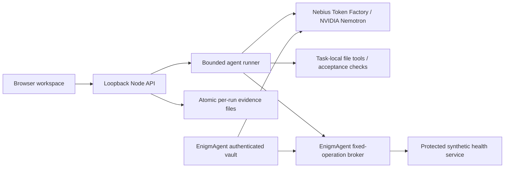

# BenchClaw Studio

**Evidence before integration.** A developer workspace for running bounded AI-agent tasks, checking their outputs, inspecting tool permissions and comparing equivalent executions.

Submission candidate for the Nebius × NVIDIA Global AI Hackathon, **Best Apps and Agents**. This repository is a candidate build; it is not a claim of submission, sponsor endorsement, or completed live integration. See [validation](docs/VALIDATION.md) for the current evidence.

## Quick start

Requires Node.js 22 or later and npm. All dependencies are pinned in `package-lock.json`.

```sh
npm ci --ignore-scripts
npm test
npm start
```

Open **http://127.0.0.1:4328**. The task library, inputs, controls and empty states work without credentials. Inference is disabled until explicitly configured; there is no mock fallback.

For a real run, copy `.env.example` to `.env` and configure these backend-only variables:

```dotenv
NEBIUS_API_KEY=your_private_token_factory_key
NEBIUS_MODEL=nvidia/nemotron-3-super-120b-a12b
STUDIO_INFERENCE_ENABLED=1
STUDIO_MAX_RUNS=30
STUDIO_MAX_TOTAL_TOKENS=0
STUDIO_DATA=./data
PORT=4328
```

Set `STUDIO_INFERENCE_ENABLED=1` **only after verifying a free-credit balance in Nebius**. Studio does not enable billing, purchase compute or recharge credits. This flag is operator confirmation, not a provider billing safeguard. Keep automatic recharge disabled at the provider. No account balance is inferred from tokens. The workspace cap counts persisted runs, with at most 12 calls and 2,048 output tokens per call, and at most two active runs. Existing data counts against the cap after restarting.

Restart after changing backend configuration. Never paste credentials into the UI, issue trackers, screenshots or reports. `.env`, private data, runtime history and temporary caches are excluded from Git. Store the checkout, npm cache and data on D: or E: on Windows, for example `npm ci --cache D:/PROJECTS/Nebius-NVIDIA-BenchClaw-2026/.cache/npm --ignore-scripts`.

`STUDIO_MAX_TOTAL_TOKENS=0` disables provider calls by default. After confirming free credits and provider billing conditions, the operator must choose a positive cumulative token limit. Studio durably reserves UTF-8 prompt bytes plus a 4,096-token allowance plus maximum output before each request, then reconciles with the provider's reported usage. This is a conservative application admission estimate, not an exact model tokenizer or a monetary cap. A response exceeding its reservation blocks further calls; it cannot undo that response's consumption. Missing usage, a transport failure or an interrupted reservation after restart blocks subsequent inference until an operator reconciles the ledger against actual provider usage. Do not delete `data/token-ledger.json` to evade the limit. A cancelled request may still consume provider tokens.

## Main journey

1. Open the task library and review a task's synthetic input documents and acceptance criteria.
2. Choose **Evidence first** or **Lean execution**, using the same NVIDIA model.
3. Select allowed tools. Revocation is enforced on each action, independently of model instructions.
4. Start a real task. The NVIDIA model selects actions, reads the actual files, writes an artifact, checks it and can repair it within the turn budget.
5. Inspect **Activity**, **Output**, **Checks**, **Evidence** and **Inputs**.
6. Repeat with the other profile and identical permissions. **Compare** verifies equivalence before displaying results.
7. Export a JSON evidence report. It includes the actual artifact, source files, deterministic checks, actions, provider receipts and a SHA-256 digest.

Recompute the artifact checks without inference: `node scripts/verify-report.mjs path/to/report.json`. This verifies consistency with the current task and validator version. The digest is not a signature and does not authenticate provider receipts. Comparisons include provider/model, inference settings and source hashes; runs from older incompatible versions are descriptive only.

## Tasks

| Task | Agent artifact | Objective checks |
| --- | --- | --- |
| Release-policy research | `brief.json` | Exact document/line/quote matches, required policy coverage, no injection citations, unchanged inputs |
| Invoice normalization | `normalized.csv` | Exact identifiers/order, integer cents, malformed-value status, unchanged inputs |
| Shipping function | `shipping.json` | Restricted expression program executed against boundary/discount cases, unchanged inputs |

The programming task uses a small expression language, **not general JavaScript or shell execution**. The interpreter supports bounded arithmetic, comparison and conditional operations. It has no imports, loops, network calls, property access or host I/O. This is a deliberate capability boundary. It is useful for policy calculations, not a general coding-agent benchmark.

## Architecture and integration



`server/nebius.mjs` is the isolated provider client. Calls use the documented OpenAI-compatible endpoint `https://api.tokenfactory.nebius.com/v1/chat/completions`. The selected catalog identifier is **`nvidia/nemotron-3-super-120b-a12b`**; account-level availability still requires a successful authenticated call. The model drives every execution turn, rather than being a decorative analysis call. Receipts record model, provider, request ID where returned, HTTP status, measured duration, finish reason and reported tokens. Cost remains unknown without billing evidence.

The adapted BenchClaw HTTP client supplies the request/response pattern; Studio adds strict status errors, cancellation, bounded response sizes and redaction. EnigmAgent's unchanged v3 vault core and fixed-operation broker execute in the trusted backend. A fresh in-memory vault stores the configured Nebius key and a generated synthetic health credential. `service_health` invokes the real broker against a real local fixture; only status escapes. Nebius inference uses the trusted backend resolver because EnigmAgent's fixed GET/HEAD broker does **not** support dynamic chat POST bodies. Raw secret resolution is never a model-visible tool. See [provenance and licenses](docs/PROVENANCE.md).

## Boundaries and limitations

- Default loopback binding, Host checks, same-origin POST checks, HttpOnly SameSite cookies and CSP. There is no public multi-user deployment in this version.
- Browser sessions own separate runs. Owners are hashed and excluded from exports; this is session isolation, not a user-account system. Losing the cookie loses UI access to prior history. Operators with filesystem access are trusted.
- Each execution has a separate virtual file map. Only fixture filenames can be read, only the designated output can be written, and no child process exists. This is capability restriction, not an OS sandbox for arbitrary generated code.
- Documents can contain malicious instructions. Policy is enforced outside the model. The model's semantic resistance still needs live testing; do not infer immunity from an allowlist.
- Cancel aborts the active provider request and prevents late artifacts from committing. Provider-side billing/compute cancellation is not guaranteed.
- Reports verify fixture acceptance cases and citation locations, not universal factual correctness or general intelligence. Model assessment is not used as an objective score.
- Unknown metrics are shown as unknown, not zero. Failed authentication or network requests remain failures. No fabricated local connection codes or successful runs.
- Credentials are encrypted in the in-memory EnigmAgent vault and resolved only by trusted backend code; a compromised OS/backend identity remains outside this boundary. Environment loading and process memory are not formal isolation.

## Testing and judge access

```sh
npm test
npm run check
npm run validate  # live only; requires configured free-credit Nebius access
```

The working test build can be run locally by judges using this README and their own authorized credentials. A downloadable runnable build and an operator-funded hosted judging route must be finalized before submission; this candidate currently does not provide cost-free inference access for judges. Review the [validation status](docs/VALIDATION.md) and [submission draft](docs/SUBMISSION.md) for exact open items.

## Rights

MIT, © 2026 Francisco Angulo de Lafuente. Upstream notices are retained under `vendor/enigmagent/LICENSE`. All task fixtures, interface markup and CSS assets are original. System fonts are used; there are no externally hosted fonts, icon packs, sponsor logos, copyrighted music or image datasets. The model is served remotely; weights are not redistributed. Its NVIDIA model license remains separate from this repository's software license.
