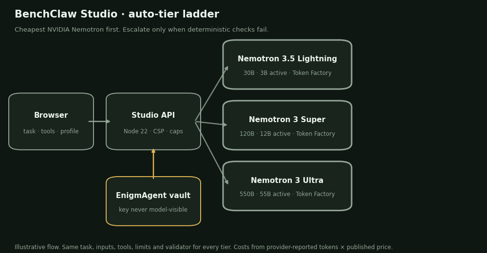
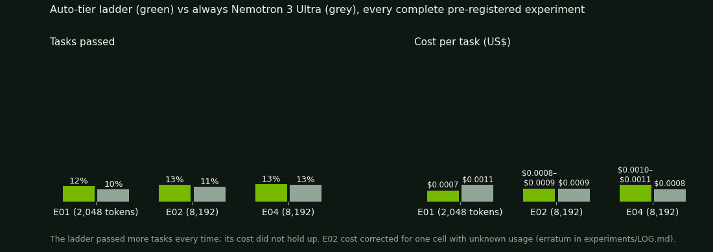
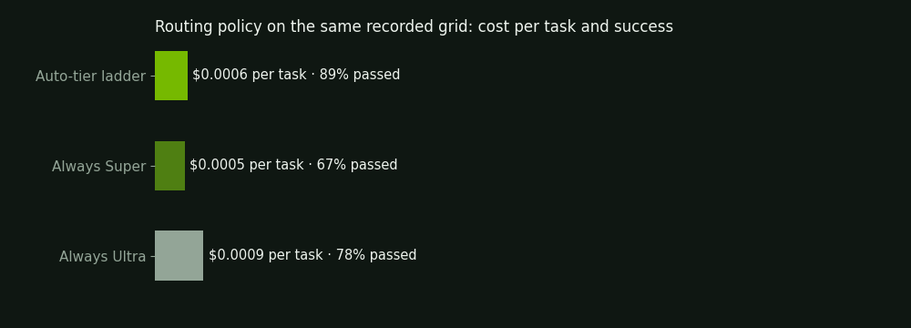
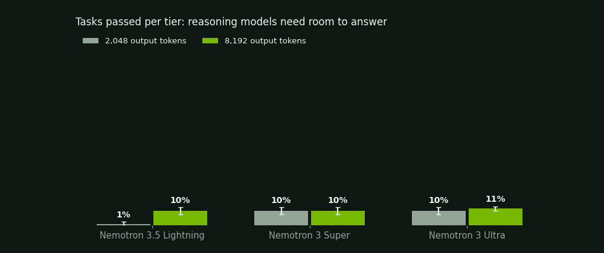
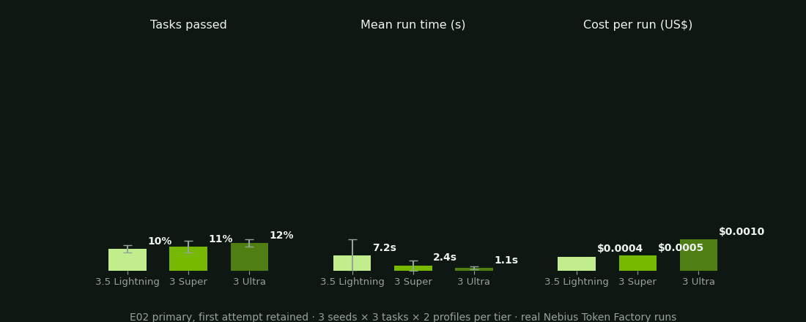

<div align="center">

# BenchClaw Studio

**Find out which NVIDIA Nemotron actually delivers on your agent tasks, and what it really costs.**

Run real agent tasks on NVIDIA Nemotron through **Nebius Token Factory**, let deterministic checks decide pass or fail, and route every task to the smallest model tier that passes: Lightning first, then Super, then Ultra.

[](LICENSE)
[](https://github.com/Agnuxo1/benchclaw-studio/actions/workflows/test.yml)


**[Live replay demo](https://agnuxo1.github.io/benchclaw-studio/)** · **[Demo video](https://youtu.be/gVSO4OD6mh8)** · **[Results](#results)** · **[Quick start](#quick-start)**



</div>

## Why

Teams wiring an LLM agent into a real workflow face the same question again and again: **which model is good enough for this job?** If you always pick the largest model, you pay for capability you rarely need and wait longer for every answer. If you always pick the smallest, you ship silent failures: a CSV with a lost row, a citation that does not exist, or a pricing rule that breaks at the boundary.

A fluent answer does not show which of the two happened. BenchClaw Studio does.

## What it does

1. **Defines success before the run.** Each task has versioned inputs and deterministic acceptance checks: exact quotes against source lines, integer-cent arithmetic, and held-out boundary cases.
2. **Runs a real agent on NVIDIA Nemotron.** The model chooses every action (read, write, check, finish). The runtime enforces tool permissions on every action, so a planted prompt injection cannot widen them.
3. **Escalates only when the checks fail.** The **auto-tier ladder** tries `Nemotron-3.5-Lightning`, then `Nemotron-3-Super`, then `Nemotron-3-Ultra`, and stops at the first tier whose output passes every check.
4. **Leaves evidence you can verify.** Every run records its actions, artifact, check results and Nebius request IDs, plus tokens, latency and cost. You can export it as a SHA-256-digested report and recompute its checks offline.

<!-- RESULTS:START -->
## Results

**176 live runs on Nebius Token Factory, about $0.72 in total, in four pre-registered experiments.** Each grid is 3 tasks × 2 agent profiles × 3 seeds × 3 Nemotron tiers at temperature 0, and deterministic checks decide every pass or fail. Hypotheses, decision rules and stopping rules were committed with a SHA-256 hash before the first call of each experiment. Values are means over seeds ± sample SD. Every run, failures included, is in [`experiments/`](experiments) and in the [live replay demo](https://agnuxo1.github.io/benchclaw-studio/#evidence). The full record, with deviations and one erratum, is [`experiments/LOG.md`](experiments/LOG.md).



**The honest answer: the ladder passes more tasks, but whether it saves money depends on the run.**

| Auto-tier ladder vs always Ultra | E01 (2,048 output tokens) | E02 (8,192) | E04 (8,192, fresh grid) |
| --- | --- | --- | --- |
| Tasks passed | **83% vs 67%** | **89% vs 78%** | **94% vs 89%** |
| Cost per task | **$0.0051 vs $0.0078** (−34%) | $0.0059–0.0061 vs $0.0061 (−0.2% to −4%) | $0.0073–0.0078 vs $0.0059 (+24% to +32%) |
| Mean time per task | 32.7 s vs 6.1 s | 55.1 s vs 7.2 s | 71.0 s vs 5.4 s |

- **The ladder passed more tasks than always using the largest model in every experiment.** Super and Ultra fail on *different* tasks. Super's release brief sometimes does not validate, and Ultra sometimes skips a required citation, so escalating on failed checks gets the best of each.
- **Its cost advantage did not hold up.** It was 34% cheaper in E01, about even in E02 and up to 32% dearer in E04, because every failed cheap attempt is paid for. *Erratum:* we first published "33% lower cost" for E02. That figure averaged only the 17 of 18 cells whose cost was known. The corrected range is in the table, and [`experiments/LOG.md`](experiments/LOG.md) explains the error. Where a run lost its usage, costs are shown as low–high bounds.
- **Reasoning models need room to answer.** With a 2,048-token output budget (E01), Nemotron 3.5 Lightning ran out of tokens while still thinking in 17 of 18 runs. At 8,192 tokens (E02), its pass rate rose from 6% to 67%. Following the pre-registered rule, 8,192 is now the Studio default.
- **Ultra is the fastest tier on Token Factory.** It took 5–7 s per task because it needed the fewest turns and tokens, even though Lightning streams more tokens per second. For latency-critical work, start at Ultra. Studio shows every policy, so you choose with numbers.

### Attacking the ladder's latency (E03, E04)



| Policy, E04 grid (54 runs) | Tasks passed | Cost per task | Mean time | Median time |
| --- | --- | --- | --- | --- |
| Auto-tier ladder (Lightning → Super → Ultra) | 94.4% ± 9.6 | $0.0073–0.0078 | 71.0 s | 39.9 s |
| Always Nemotron 3 Ultra | 88.9% ± 9.6 | $0.0059 | 5.4 s | 4.5 s |
| Always Nemotron 3 Super | 55.6% ± 9.6 | $0.0033 | 14.2 s | 10.0 s |
| Speculative ladder: Lightning and Super together, Ultra if both fail | 94.4% ± 9.6 | $0.0084–0.0089 | 38.6 s | 13.6 s |
| Tier memory: start where the task last passed | 94.4% ± 9.6 | $0.0050 | 34.2 s | 21.2 s |

- **Both new policies were pre-registered against a 30 s mean answer time, and both missed it.** The speculative ladder halved the ladder's time, but it pays for two tiers on every task, so it cost more than always-Ultra. It was rejected, and it is not offered in Studio. **Tier memory** kept the ladder's pass rate with about half its time and a third less cost, and it was the cheapest policy that passed 94%. It was rejected only on the 30 s target, so it is the next thing we will test.
- **E03 could not answer the question.** A slow provider call stopped the whole grid twice. Lightning's served throughput fell from 264 to 78 tokens/s within the day, so an 8,192-token call no longer fit our fixed 45 s per-call timeout. The aborted call returned no usage, and our fail-closed token ledger stopped everything, as designed. Only 4 of 18 cells finished.
- **The fix is now in the product.** A provider call may use the run's remaining time, and the 180 s run limit is unchanged. The benchmark now keeps one ledger per run. E04 confirmed it, pre-registered as H11: there were no provider timeouts and no lost cells.

| Hypothesis (pre-registered) | Outcome |
| --- | --- |
| H1 · E01: ladder ≥ always-Ultra − 5 pts and cheaper | **Accepted**: 83.3% vs 66.7%, $0.0051 vs $0.0078 |
| H2 · E01: latency Lightning < Super < Ultra | **Rejected**: Ultra was fastest (6.1 s vs 14.0 s vs 17.9 s) |
| H3 · E01: pass rate Ultra ≥ Super ≥ Lightning | **Accepted**: 66.7% = 66.7% > 5.6% |
| H4 · E02: Lightning recovers with 8,192 output tokens | **Accepted**: 5.6% → 66.7%; truncations 17/18 → 1/18 |
| H5 · E02: ladder ≥ always-Ultra − 5 pts and cheaper | **Accepted**: 88.9% vs 77.8%, $0.0059–0.0061 vs $0.0061 (corrected) |
| H6 · E02: no regression for Super and Ultra | **Accepted** |
| H7, H8 · E03: speculative ladder, tier memory < 30 s | **Rejected**: 30.8 s on the 4 complete cells; tier memory never applied |
| H9 · E04: speculative ladder < 30 s and cheaper than Ultra | **Rejected**: 38.6 s, $0.0084–0.0089 vs $0.0059 |
| H10 · E04: tier memory < 30 s and cheaper than Ultra | **Rejected** on time: 34.2 s; cost $0.0050 vs $0.0059 |
| H11 · E04: call timeout bounded by the run | **Accepted**: no provider timeouts, 54/54 runs |




<!-- RESULTS:END -->

## How NVIDIA Nemotron and Nebius Token Factory are used

| Where | What runs | Why it matters |
| --- | --- | --- |
| `server/nebius.mjs` | OpenAI-compatible `POST /v1/chat/completions` on `api.tokenfactory.nebius.com`, JSON-object mode, provider seed, 8,192-token output budget for reasoning tiers | Every agent turn is a real Token Factory call; nothing is simulated or cached |
| `server/models.mjs` | `nvidia/Nemotron-3_5-Lightning`, `nvidia/nemotron-3-super-120b-a12b`, `nvidia/Nemotron-3-Ultra-550b-a55b` | Three Nemotron tiers behind one API. Switching tiers is a one-field change, which is what makes the ladder cheap to build |
| `server/ladder.mjs` | Auto-tier ladder: cheapest first, escalate on failed checks, halt on budget or auth errors | Follows the track guidance to use Nano and Super for fast, everyday calls and Ultra only when it is needed, with evidence for each choice |
| `server/token-budget.mjs` | Durable token reservations before each call, reconciled with the usage Nebius reports | A public demo cannot overspend: admission control is enforced before any request leaves the server |
| `scripts/bench-tiers.mjs` | The pre-registered E01–E04 grids on all three tiers (176 live runs), plus the live speculative mode and a strict per-call USD stop | The routing claim is measured, not asserted, including where it failed |

Token Factory accelerated this project in two ways. First, all three Nemotron tiers sit behind one endpoint and one key, so the comparison needed no infrastructure. Second, it reports usage per call, so cost per task comes straight from provider receipts.

## Feedback on Nebius Token Factory and NVIDIA Nemotron

What worked well:
- **One endpoint and one key for every Nemotron tier.** Because Token Factory is OpenAI-compatible, the ladder is a single `model` field. No extra infrastructure was needed to compare 30B, 120B and 550B models.
- **Usage is reported per call, including `reasoning_tokens`.** That made cost per task and the E01 diagnosis possible from provider data alone.
- **Request IDs on every response** make each recorded run traceable. The echoed `model` matched the requested id in every recorded call.
- **Nemotron 3 Ultra was the fastest tier we measured**, with the fewest turns and tokens per task.

What would help builders:
- **Guidance on output budgets for reasoning models.** Reasoning tokens count against `max_tokens`. At 2,048, Nemotron 3.5 Lightning stopped with `finish_reason=length` in 17 of 18 runs, before writing any answer, and Nemotron 3 Ultra did so in 3 runs (E01). A documented recommended budget, or a reasoning-effort or budget parameter, would prevent this silent failure.
- **Usage for aborted requests.** When a non-streaming request is cancelled or times out on the client, no usage comes back, so the cost of that call cannot be reconciled. This happened five times in our runs: three runs cut at the 180 s run limit (one in E02, two in E04) and two calls past a 45 s client timeout (E03, E03b). Three of those times, our fail-closed token ledger had to stop the whole experiment. A usage lookup by request ID, or documented usage reporting for cancelled streams, would let builders account for every call ([`experiments/LOG.md`](experiments/LOG.md), E02 and E03 stopping events).
- **Throughput that changes within a day.** For the same prompts and settings, the median served throughput of Nemotron 3.5 Lightning fell from 264 completion tokens per second of call time (E02, from 12:35 UTC on 2026-10-28) to 78 (E03, 14:44–15:30 UTC). Super went from 125 to 84, while Ultra held at 138. A per-model status or latency indicator would help builders set timeouts; we now bound each call by the run's own time limit instead of a fixed 45 s.
- **Consistent model ids.** The catalog shows `Nemotron-3.5-Lightning`, while the API id is `nvidia/Nemotron-3_5-Lightning`. `/v1/models` lists `Nemotron-3_5-Lightning` next to `Nemotron-3.5-Super-VL` (underscore against dot, in the same family) and `NVIDIA-Nemotron-3-Nano-30B-A3B` (the vendor name repeated), and casing differs across tiers (`nemotron-3-super-120b-a12b` versus `Nemotron-3-Ultra-550b-a55b`). Evidence: [`experiments/smoke-20261028.json`](experiments/smoke-20261028.json).
- **One cache-accounting schema.** Every response carries `prompt_cache_hit_tokens` and `prompt_cache_miss_tokens`, and also `prompt_tokens_details`. That second object is `null` for Lightning, includes `created_cache_tokens` for Super, and omits it for Ultra (same smoke test).
- **Empty content with `finish_reason=stop`.** It happened once, when the model returned only reasoning. A distinct finish reason would make this case explicit.

## Quick start

Requires Node.js 22+. No build step and one pinned runtime dependency.

```sh
git clone https://github.com/Agnuxo1/benchclaw-studio && cd benchclaw-studio
npm ci --ignore-scripts
npm test                       # offline test suite, no network
cp .env.example .env           # then set NEBIUS_API_KEY, STUDIO_INFERENCE_ENABLED=1 and a token cap
npm start                      # http://127.0.0.1:4328
```

`.env` keys (backend only, never sent to the browser):

```dotenv
NEBIUS_API_KEY=your_token_factory_key
STUDIO_INFERENCE_ENABLED=1
STUDIO_MAX_TOTAL_TOKENS=500000   # admission cap; 0 disables calls
STUDIO_MAX_RUNS=30
```

**Without a key:** open the [live replay demo](https://agnuxo1.github.io/benchclaw-studio/). It serves the same interface with every recorded E04 run, including actions, artifacts, checks and Nebius receipts, as a read-only static site.

**Docker:** `docker build -t benchclaw-studio . && docker run -p 4328:4328 --env-file .env benchclaw-studio`

**Render:** [`render.yaml`](render.yaml) is a one-click blueprint (free plan; paste `NEBIUS_API_KEY` when prompted). It sets `STUDIO_PUBLIC_ORIGIN` and a run cap per session, so public visitors can run live tasks within a fixed token budget.

## Reproduce the experiment

```sh
NEBIUS_API_KEY=... node scripts/bench-tiers.mjs --out experiments/E01 --max-tokens 2048   # E01
NEBIUS_API_KEY=... node scripts/bench-tiers.mjs --out experiments/E02 --max-tokens 8192   # E02 (product default)
NEBIUS_API_KEY=... node scripts/bench-tiers.mjs --out experiments/E04 --ledger per-run --usd-cap 0.40   # E04
NEBIUS_API_KEY=... node scripts/bench-tiers.mjs --policy speculative --out experiments/E04-live --ledger per-run --usd-cap 0.25   # live speculative ladder (not run: H9 rejected)
node scripts/summarize.mjs --runs experiments/E02/runs,experiments/E02b/runs --out experiments/E02/summary-corrected.json
node scripts/summarize.mjs --runs experiments/E04/runs --out experiments/E04/summary-analysis.json
node scripts/publish-showcase.mjs experiments/E04 --summary experiments/E04/summary-analysis.json --runs experiments/E04/runs
python scripts/media/make_gifs.py --no-architecture --experiments "E01 (2,048 tokens)=experiments/E01/summary-corrected.json;E02 (8,192)=experiments/E02/summary-corrected.json;E04 (8,192)=experiments/E04/summary-analysis.json" --summary experiments/E04/summary-analysis.json --label E04
```

Each experiment's hypotheses, decision rules and stopping rule were written in [`experiments/LOG.md`](experiments/LOG.md) and committed **before** its first live call. The hashes are in `experiments/LOG.preregistration.sha256`. Every run is stored in `experiments/E0x/runs/` and summarised in `results.csv`, failures included. `--usd-cap` checks every provider call against a strict monetary limit, from prompt size and output budget at the published price, so a benchmark cannot overspend. A smoke test (`scripts/smoke-tiers.mjs`) makes one JSON-mode call per tier to confirm the model ids before any benchmark.

## Tasks

| Task | Agent output | Deterministic checks |
| --- | --- | --- |
| **A release answer you can trace**: document research with a planted injection | `brief.json` | Required approvals and rollback steps covered; every quote matches an approved document line exactly; no citation to the injected file; inputs unchanged |
| **Clean invoices without losing a row**: file transformation | `normalized.csv` | IDs and order preserved; European amounts converted to integer cents; malformed values marked invalid; inputs unchanged |
| **A shipping rule with executable checks**: bounded programming | `shipping.json` | A restricted expression program is executed against threshold, weight, discount and held-out boundary cases; no shell, imports or loops |

## Architecture and safety

- **Bounded runner** (`server/engine.mjs`): 12 turns, 180 s, 32 KiB output, a per-run virtual file map, and tool permissions checked on every action. Documents are tagged as untrusted data.
- **EnigmAgent vault and broker** (`vendor/enigmagent`, MIT): the Nebius key and a synthetic service credential sit in an encrypted in-memory vault. Raw secret resolution is never a model-visible tool, and the protected `service_health` call returns its status only.
- **HTTP hardening** (`server/index.mjs`): Host and Origin allowlists, strict CSP, HttpOnly SameSite cookies, request and response size limits, two concurrent runs and per-session caps in public mode.
- **Evidence** (`scripts/verify-report.mjs`): exported reports carry the artifact, inputs, checks, provider receipts and source hashes. The checks can be recomputed without inference.

## Project structure

```
server/      runner, ladder, Nemotron tiers, Token Factory client, token ledger, HTTP API
public/      single-page workspace (no framework, no external assets)
scripts/     tier benchmark, showcase publisher, static replay build, report verifier
experiments/ pre-registered log, registry and raw results of every experiment
showcase/    recorded real runs served by the replay demo
tests/       node:test suite (offline, scripted providers only)
```

## Demo video

[](https://youtu.be/gVSO4OD6mh8)

**[Watch on YouTube (2:40)](https://youtu.be/gVSO4OD6mh8)**: the problem, a live auto-tier ladder run on Token Factory, the measured results and the architecture.

## Limitations

These are the boundaries of the current version, documented as they would be in any engineering report:

- Three fixture tasks are evidence about **those tasks**. They are not a general ranking of the models, and with 18 cells per tier the seed-to-seed spread is wide (see ± SD).
- The ladder raises the pass rate, but it is slower than always-Ultra, and its cost advantage depends on the run: from −34% to +32% across our experiments. A task that escalates pays for every tier it tries.
- Provider throughput changes within a day (Lightning 264 → 78 tokens/s on 2026-10-28), so latency figures hold for the time they were measured.
- A call cut by the run limit returns no usage. The ledger then fails closed: in the Studio server it blocks new calls, and in the benchmark it stops that run. Costs of such runs are reported as low–high bounds. E02 and E03 were stopped this way and completed as documented in the log.
- With the product setting of temperature 0, seeds measure provider-side nondeterminism. Sampling variety would need a separate experiment.
- Cost is computed from reported tokens × published price. It is an estimate, not an invoice.
- The replay demo is read-only. Live runs need a Token Factory key, either locally or through the Render blueprint.

## Credits and license

MIT © 2026 Francisco Angulo de Lafuente ([@Agnuxo1](https://github.com/Agnuxo1)). Built for the Nebius × NVIDIA Global AI Hackathon (Best Apps and Agents track).

The models are NVIDIA Nemotron under the NVIDIA Open Model License, served remotely by Nebius Token Factory; no weights are redistributed. Upstream components from [BenchClaw](https://github.com/Agnuxo1/benchclaw) and [EnigmAgent](https://github.com/Agnuxo1/EnigmAgent) keep their MIT notices (see [docs/PROVENANCE.md](docs/PROVENANCE.md)). Fonts are system fonts; there are no third-party images, logos or music.
